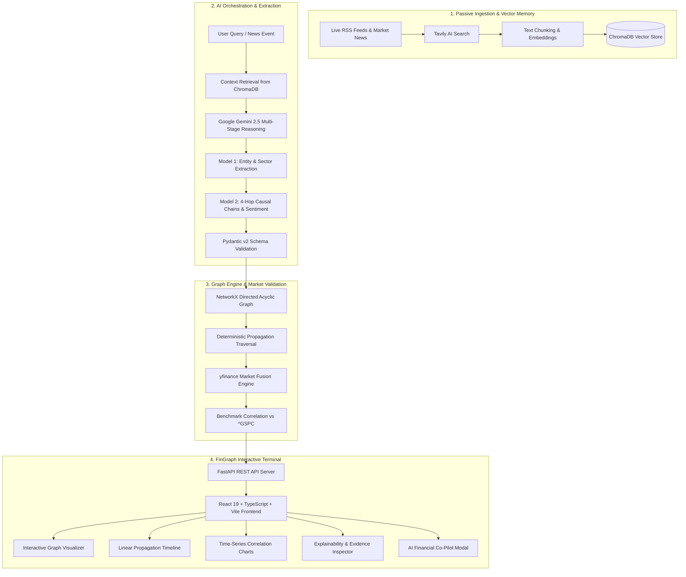

# FinGraph (SCYP_X) 📈⚡
### AI-Powered Financial Event Impact Propagation Graph & Explainable AI (XAI) Terminal

[](https://fastapi.tiangolo.com)
[](https://react.dev)
[](https://vitejs.dev)
[](https://www.python.org)
[](https://deepmind.google/technologies/gemini)
[](https://www.trychroma.com)
[](https://networkx.org)
[](LICENSE)

---

## 📌 Executive Summary & Problem Statement

Financial events rarely impact a single company in isolation. A geopolitical conflict, commodity price swing, interest-rate decision, or regulatory change propagates through intermediate supply chains, industrial sectors, and financial instruments. Traditional market terminals present breaking news as isolated stories rather than connected causal chains.

**FinGraph (SCYP_X)** solves this challenge by converting unstructured financial news and macro events into a **dynamic, multi-hop causal dependency graph**. It automatically extracts entities, scores directional relationships, traces deterministic transmission paths from root shocks to downstream equity indices, validates price effects against empirical market data, and grounds every inference in auditable source evidence.

---

## 🚀 Key Capabilities

- **Deterministic 4-Hop Impact Propagation**:
  - **Hop 0 (Root Shock):** Primary event trigger (e.g., *Crude oil prices rise 12% following OPEC supply cut*).
  - **Hop 1 (Commodity & Upstream):** Direct commodity benchmarks and exploration profit (e.g., Brent Crude, XLE Energy).
  - **Hop 2 (Sector Contagion & Overheads):** Inflation expectations (CPI) and transport/manufacturing input costs.
  - **Hop 3 (Corporate Margins & Credit):** Operating margins (DAL Airlines, XLI Industrials) and bank lending conditions.
  - **Hop 4 (Macro Indices & Spillover):** Broad market valuation repricing (Banking XLF, Real Estate XLRE, S&P 500 SPY).
- **Multi-Model Orchestration**: Structured causal extraction using Google Gemini (`gemini-2.5-flash` / `pro`) enforced by Pydantic v2 schemas.
- **Quantitative Market Validation**: Real-time integration with `yfinance` to validate empirical price changes, volatility deltas, and correlation against benchmark indices (`^GSPC`).
- **Autonomous Passive Vector Ingestion**: Background workers poll live RSS news feeds and Tavily AI Search, generating semantic embeddings stored locally in ChromaDB.
- **Explainable AI (XAI) & Audit Trail**: Every causal edge is backed by an auditable evidence card classified into **Fact** (extracted from verified reports) vs. **Inference** (AI-derived logical deduction) with confidence scores.
- **Interactive Visualizer Terminal**: High-performance canvas featuring concentric reticle bullseyes, progressive node expansion on click, zero-collision badge geometry, and synchronized side inspectors.
- **Instant AI Financial Co-Pilot**: Context-aware assistant providing qualitative scenario analysis and portfolio hedge recommendations.
- **Guaranteed Demo Stability**: Zero-friction offline fallback mode (`USE_MOCK_DATA`) ensures 100% demo reliability even without external API credentials.

---

## 🏗️ System Architecture



---

## 💻 Interactive Application Modules

| Module | Description |
| :--- | :--- |
| **Landing Page** | Executive overview featuring a video demo walkthrough, architectural highlights, and live scenario launchpad. |
| **Financial Intelligence (Home)** | Real-time news feed stream, macro scenario selector, ingestion health monitor, and key metrics. |
| **Graph Visualizer** | Interactive canvas rendering concentric bullseye nodes with progressive expansion, hop-level filtering, zoom/pan controls, and entity inspectors. |
| **Propagation Path** | Sequential causal step-by-step breakdown illustrating shock transmission timelines and asset sensitivity deltas. |
| **Time-Series Analysis** | Quantitative validation charts displaying historical pricing curves, benchmark correlations (`^GSPC`), and volatility stats. |
| **Explainability & Evidence (XAI)** | Audit inspector matching every causal link to source text excerpts, publication timestamps, and Fact vs. Inference classifications. |

---

## 🛠️ Technology Stack

### Backend
- **Framework:** FastAPI with Uvicorn
- **Language:** Python 3.12
- **Graph Processing:** NetworkX
- **Vector Database:** ChromaDB with Sentence-Transformers
- **AI / LLM:** Google GenAI SDK (`google-genai` / Gemini 2.5 Flash & Pro)
- **Quantitative Market Data:** `yfinance`, Pandas, NumPy
- **Data Ingestion:** `feedparser`, Tavily API
- **Type Validation:** Pydantic v2

### Frontend
- **Framework:** React 19 + TypeScript
- **Bundler:** Vite 8
- **Animation & Transitions:** Framer Motion
- **Iconography:** Lucide React
- **Design System:** Custom CSS Terminal tokens, Inter & Plus Jakarta Sans typography

### Deployment & CI/CD
- **Platform:** Render (Unified Python + Node.js Web Service)
- **Blueprint:** `render.yaml` with automated `build.sh`

---

## 📂 Repository Structure

```
SCYP_X/
├── Backend/
│   ├── app/
│   │   ├── main.py              # FastAPI application & REST route definitions
│   │   └── ...
│   ├── modules/
│   │   ├── graph_engine.py      # NetworkX causal graph construction & traversal
│   │   ├── orchestrator.py      # Gemini multi-model causal reasoning pipeline
│   │   ├── market_data.py       # yfinance quantitative price & correlation fetcher
│   │   ├── ingestion.py         # Background RSS & Tavily ingestion worker
│   │   ├── vector_db.py         # ChromaDB semantic search interface
│   │   ├── test_graph_engine.py # Comprehensive unit tests
│   │   └── test_orchestrator.py # Integration validation tests
│   ├── data/                    # Pre-cached fallback fixtures (deterministic demo safety)
│   ├── main.py                  # Server entrypoint
│   └── requirements.txt         # Python dependencies
├── Frontend/
│   ├── src/
│   │   ├── components/
│   │   │   ├── NetworkGraph.tsx # Concentric reticle graph with progressive expansion
│   │   │   └── AICoPilot.tsx    # Context-aware financial AI assistant
│   │   ├── services/
│   │   │   └── api.ts           # Unified API client with automatic mock fallback
│   │   ├── utils/               # Sector classifiers and formatting utilities
│   │   ├── App.tsx              # Main application shell & tab routing
│   │   └── index.css            # Dark/light executive terminal styling
│   ├── package.json             # Frontend dependencies
│   └── vite.config.ts           # Vite build configuration
├── build.sh                     # Unified Render build script
├── render.yaml                  # Render deployment blueprint
├── start_all.bat                # Windows 1-click dual-server launcher
├── run.ps1                      # PowerShell dual-server launcher
└── README.md                    # Project documentation
```

---

## ⚙️ Getting Started Locally

### Prerequisites
- **Python:** 3.11 or 3.12 installed
- **Node.js:** 20.x or 22.x with `npm`
- **Git**

### 1. Clone the Repository
```bash
git clone https://github.com/Nikhil9131/SCYP_X.git
cd SCYP_X
```

### 2. Configure Environment Variables (Optional)
Create a `.env` file in the root directory (or export variables in your shell):
```env
# Optional: Set your Gemini API key for live LLM reasoning
GEMINI_API_KEY=your_gemini_api_key_here

# Optional: Set your Tavily API key for live web search ingestion
TAVILY_API_KEY=your_tavily_api_key_here

# Set to True to force offline deterministic mock data (Default: False)
USE_MOCK_DATA=False
```
> *Note: If no API keys are provided, FinGraph automatically falls back to pre-computed institutional demo scenarios, guaranteeing 100% uptime.*

---

### 3. Launch with One Click (Windows)

Double-click `start_all.bat` or run in PowerShell:
```powershell
.\start_all.bat
```
This automatically initializes the Python virtual environment, installs requirements, installs frontend packages, and launches both services:
- **Frontend:** [http://localhost:5173](http://localhost:5173)
- **Backend API:** [http://localhost:8000](http://localhost:8000) (Interactive Docs: [http://localhost:8000/docs](http://localhost:8000/docs))

---

### 4. Manual Setup (Linux / macOS / Manual Windows)

#### Step 4A: Backend Setup
```bash
# Create and activate virtual environment
python -m venv .venv
source .venv/bin/activate  # On Windows: .venv\Scripts\activate

# Install backend dependencies
pip install -r requirements.txt

# Start FastAPI server
python -m uvicorn Backend.main:app --host 0.0.0.0 --port 8000 --reload
```

#### Step 4B: Frontend Setup (in a separate terminal)
```bash
cd Frontend
npm install
npm run dev
```

Open [http://localhost:5173](http://localhost:5173) in your browser.

---

## 🧪 Running Automated Tests

Run the complete backend test suite:
```bash
python -m unittest discover -s Backend/modules
```
Verify the frontend production bundle:
```bash
npm --prefix Frontend run build
```

---

## ☁️ Deployment on Render

This repository includes a production-grade [render.yaml](render.yaml) blueprint and [build.sh](build.sh) script that builds both the React SPA and serves it through FastAPI:

1. Link your GitHub repository to [Render](https://render.com).
2. Select **New > Blueprint** and choose `render.yaml`.
3. Add `GEMINI_API_KEY` (and optionally `TAVILY_API_KEY`) under Environment Variables.
4. Deploy! Render will build the Vite frontend bundle, configure the Python environment, and expose the live application.

---

## 🛡️ License

This project is licensed under the MIT License — see the [LICENSE](LICENSE) file for details.
